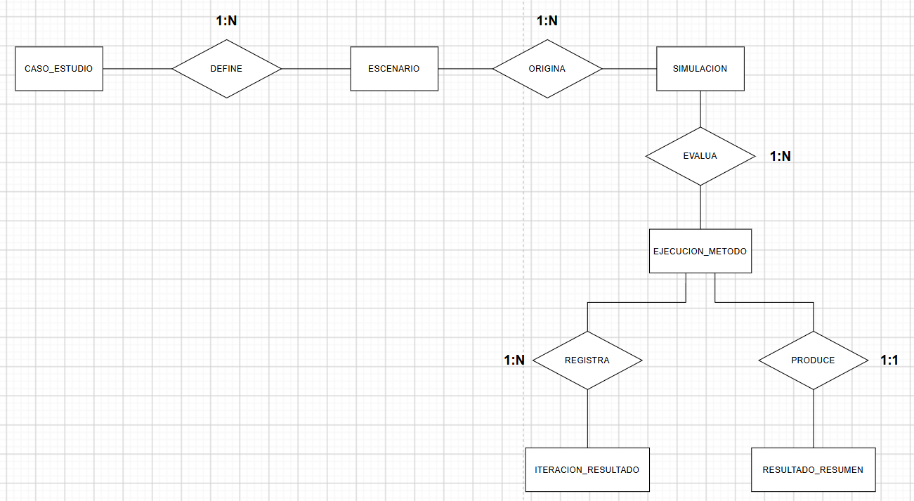

# 🚡 SIMTELE-RISK: Sistema Integrado de Simulación y Métodos Numéricos

**SIMTELE-RISK** es una aplicación web full-stack diseñada para la simulación, evaluación y análisis numérico de un sistema de transporte por cable (inspirado en *Mi Teleférico* de La Paz). Centraliza los 4 módulos obligatorios desarrollados desde cero en Python, con persistencia en base de datos relacional SQLite e interfaz interactiva multiescenario.

🌐 **Aplicación web en vivo:** *(Pega aquí tu enlace de Render cuando termine el despliegue)*

---

## Módulos y Métodos Implementados (Semana 1 y Semana 2)

1. **Detención de Emergencia (Raíces):** Evaluación del tiempo y distancia de frenado ($v(t) = 0$) mediante **Bisección**, **Newton-Raphson** y **Secante**, con apoyo de integración numérica y EDOs (`/api/modulo1_apoyo/<tipo>`).
2. **Deterioro Mecánico y Mantenimiento (Sistemas Lineales y Raíces):** Calibración del sistema lineal $4 \times 4$ mediante **Factorización LU con Pivoteo Parcial** y **Gradiente Conjugado**, cálculo del número de condición $\kappa(A)$ y estimación del cruce de umbral $D(t) - D_{\text{umbral}} = 0$.
3. **Oscilaciones por Viento (EDO e Integración Numérica):** Simulación de oscilador amortiguado forzado mediante **Runge-Kutta 2 (Heun)** y **Runge-Kutta 4 (RK4)** frente a la solución analítica exacta, cálculo de energía acumulada $\int x(t)^2\,dt$ con **Trapecio**, **Simpson 1/3** y **Romberg**, y análisis de sensibilidad en resonancia.
4. **Reconstrucción de Sensores (Interpolación):** Reconstrucción de telemetría ante pérdida de datos mediante **Lagrange**, **Diferencias Divididas de Newton (Horner)** y **Splines Cúbicos Naturales (algoritmo de Thomas)**, incluyendo demostración del fenómeno de Runge.

---

## Escenarios de Evaluación

Cada módulo permite ejecutar simulaciones en tres condiciones experimentales:

* **NORMAL:** Parámetros nominales y datos bien comportados como caso de control.
* **ESTRÉS:** Exigencias operativas elevadas (pasos grandes, perturbaciones fuertes o pérdida agresiva de ~72% de lecturas).
* **MAL CONDICIONADO:** Alta sensibilidad matemática (alto número de condición $\kappa(A) \approx 4002$, resonancia con amortiguamiento casi nulo y función de Runge $y(t) = \frac{1}{1+25t^2}$).

---

## Arquitectura y Tecnologías

* **Backend:** Python 3, Flask, Flask-CORS, Gunicorn, NumPy, Matplotlib.
* **Frontend:** HTML5, Bootstrap 5, Chart.js.
* **Base de Datos:** SQLite (`database/simtele.db`) con esquema relacional de 6 tablas (`caso_estudio`, `escenario`, `simulacion`, `ejecucion_metodo`, `iteracion_resultado`, `resultado_resumen`).

---

## Estructura del Repositorio

```text
.
├── backend/
│   ├── app.py                     # Servidor Flask y endpoints REST (/api/...)
│   ├── database.py                # Gestión de SQLite e historial
│   ├── raices.py                  # Módulo 1 y umbral de Módulo 2
│   ├── metrics.py                 # Métricas transversales de error
│   └── models/
│       ├── modulo2_deterioro/     # Factorización LU, Gradiente Conjugado y escenarios
│       ├── modulo3_oscilaciones/  # RK2, RK4, Trapecio, Simpson, Romberg y pruebas
│       └── modulo4_sensores/      # Lagrange, Newton y Splines Cúbicos Naturales
├── frontend/
│   └── index.html                 # Interfaz web multiescenario y tabla de historial
├── database/
│   ├── schema.sql                 # Esquema relacional SQL
│   ├── der.png                    # Diagrama Entidad-Relación
│   └── simtele.db                 # Base de datos SQLite
├── tests/                         # Scripts de pruebas unitarias
├── docs/                          # Documentación e informes
├── requirements.txt               # Dependencias del proyecto
└── README.md
```



---

## Instalación y Ejecución Local

1. **Clonar el repositorio:**
   ```bash
   git clone [https://github.com/rodrigo-borras-anze/SIMTELE-RISK-DESAF-O-INTEGRADOR-FINAL.git](https://github.com/rodrigo-borras-anze/SIMTELE-RISK-DESAF-O-INTEGRADOR-FINAL.git)
   cd SIMTELE-RISK-DESAF-O-INTEGRADOR-FINAL
   ```

2. **Crear y activar el entorno virtual:**
   ```bash
   python -m venv .venv
   # En Windows (PowerShell):
   .\.venv\Scripts\Activate.ps1
   ```

3. **Instalar dependencias:**
   ```bash
   pip install -r requirements.txt
   ```

4. **Ejecutar el servidor:**
   ```bash
   python -m backend.app
   ```

5. Abrir en el navegador: `http://localhost:5000`

---

## Endpoints Principales de la API

| Ruta | Descripción |
| :--- | :--- |
| `GET /` | Interfaz web principal |
| `GET /api/modulo1/<escenario>` | Simulación de detención de emergencia (`NORMAL`, `ESTRES`, `MAL_CONDICIONADO`) |
| `GET /api/modulo2/<escenario>` | Calibración LU / Gradiente Conjugado + cruce de umbral |
| `GET /api/modulo3/<escenario>` | Oscilaciones RK2/RK4, integrales y sensibilidad |
| `GET /api/modulo4/<escenario>` | Reconstrucción con Lagrange, Newton y Splines Cúbicos |
| `GET /api/modulo1_apoyo/<tipo>` | Apoyo de frenado con EDOs


